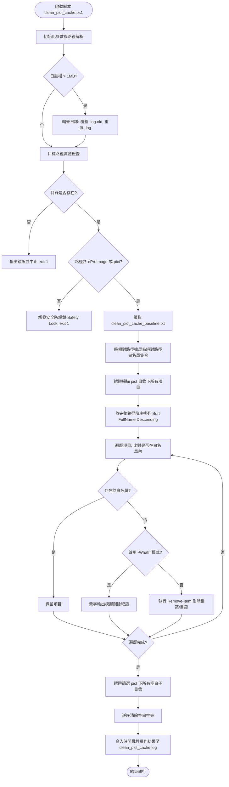

# Pict Cache Cleaner (v2.0)
作者: [linuxfab](https://github.com/linuxfab) ([https://github.com/linuxfab/clean_eproiamge_pic](https://github.com/linuxfab/clean_eproiamge_pic))  
最後更新時間: 2026-10-28 00:58

---

## 1. 專案概述 (Project Overview)
本工具為專為 Windows 生產環境設計之自動化快取管理系統，主要針對醫療影像軟體 (`eProImage`) 頻繁產生、無限制膨脹之 `pict` 圖像快取目錄進行安全精確的白名單重置。

傳統快取清除往往採用粗暴的「全部清空」或「按副檔名過濾」，極易誤刪系統初始骨幹結構或引發軟體載入崩潰。本工具透過宣告式「基準線模型 (`clean_pict_cache_baseline.txt`)」，在每一次執行時建立記憶體白名單樹狀索引，僅刪除使用者操作後衍生之暫存縮圖與影像檔，並自動修剪殘留之空殼目錄。

專案已將原始碼與發行產物分離，打包壓縮包由 [GitHub Releases](https://github.com/linuxfab/clean_eproiamge_pic/releases) 獨立託管，儲存庫專注於核心維護與版本控管。

---

## 2. 系統架構與執行流程 (Architecture & Flow)

以下為腳本執行時的狀態機與決策流程圖：



---

## 3. 核心設計機制 (Core Mechanisms)

### 3.1 逆序刪除演算法 (Descending Path Traversal)
在處理樹狀階層檔案系統時，若先刪除父目錄，子目錄查詢將拋出例外；若正向刪除，迭代器指針容易失效。本工具採用路徑字串長度與字母的**降序排列 (`Sort-Object -Property FullName -Descending`)**：
1. 最深層的子檔案與子資料夾最先被處理與刪除。
2. 逐層向上收斂，確保刪除操作的原子性與安全性。

### 3.2 雙層防爆安全鎖 (Safety Lock)
為防止維運人員誤傳入根目錄（如 `C:\`、`D:\`）導致毀滅性刪除，腳本內建路徑字串嚴格檢核：
```powershell
if ($TargetDir -notlike "*\eProImage*" -and $TargetDir -notlike "*\pict*") {
    Write-Error "ABORT: Target path '$TargetDir' does not look like an eProImage or pict folder! Safety lock enabled."
    exit 1
}
```
凡未包含明確軟體目錄關鍵字之路徑，一律拒絕執行並強制中斷。

### 3.3 日誌自動滾動 (Log Rotation)
日誌預設保留於腳本同層之 `clean_pict_cache.log`。每次啟動時自動檢查檔案容量，超過 1MB 時自動轉存為 `.log.old` 並開闢新日誌，保證磁碟空間不因長久排程而耗盡。

---

## 4. 基準線資料結構 (Baseline Data Schema)

基準線檔案 `clean_pict_cache_baseline.txt` 為純文字檔案，採用 **UTF-8 (無 BOM)** 編碼。每行定義系統預設必須留存的**相對路徑節點**（大小寫不敏感）：

### 4.1 白名單清單內容
```text
pict\null_0
pict\tmb
pict\null_0\null
pict\tmb\l
pict\tmb\m
pict\tmb\s
pict\tmb\l\null_0
pict\tmb\l\null_0\null
pict\tmb\m\null_0
pict\tmb\m\null_0\null
pict\tmb\s\null_0
pict\tmb\s\null_0\null
```

### 4.2 結構對應樹狀圖 (Directory Structure Map)
```
C:\YOUSING\eProImage\pict/
├── null_0/
│   └── null                    <-- 系統核心錨定點 (保留)
└── tmb/                        <-- 縮圖快取根目錄 (保留)
    ├── l/                      <-- 大尺寸縮圖目錄 (保留)
    │   └── null_0/
    │       └── null            <-- 骨幹節點 (保留)
    ├── m/                      <-- 中尺寸縮圖目錄 (保留)
    │   └── null_0/
    │       └── null            <-- 骨幹節點 (保留)
    └── s/                      <-- 小尺寸縮圖目錄 (保留)
        └── null_0/
            └── null            <-- 骨幹節點 (保留)
```
*所有在日常看診/閱片過程中動態生成的快取影像（例如 `tmb\l\12345.jpg`、`tmb\m\20261028_001.png`）均不在白名單中，將在清理時被全面剔除。*

---

## 5. 檔案結構與元件清單 (Repository Layout)

| 檔案名稱 | 類型 | 說明 |
| :--- | :--- | :--- |
| `clean_pict_cache.ps1` | 核心程式 | 主清理邏輯腳本，支援參數指定目標路徑與 `-WhatIf` 預覽開關。 |
| `clean_pict_cache_baseline.txt` | 資料設定檔 | UTF-8 格式白名單基準線，定義受保護的目錄骨幹結構。 |
| `clean_pict_cache.log` | 執行紀錄 | 自動記錄每次清理目標、刪除檔名、刪除數量與錯誤訊息。 |
| `clean_pict_cache.log.old` | 滾動紀錄 | 超過 1MB 輪替備份之舊紀錄。 |
| `README.md` | 系統文件 | 系統架構、排程指引與工程維運指南。 |
| `agent-logs.md` | 版本歷程 | 歷次修正與維護之時間戳紀錄檔。 |
| `.gitignore` | 版本忽略 | 排除 `clean_cache.zip`、`*.log`、`*.log.old` 等建置與暫存檔。 |

> **發布離線包**：部署於無網路環境之電腦時，請至 [Releases 頁面](https://github.com/linuxfab/clean_eproiamge_pic/releases) 下載最新之 `clean_cache.zip`，解壓縮後即可直接運作。

---

## 6. 使用與操作指南 (Operation Guide)

### 6.1 手動即時執行 (Manual Run)
以預設路徑 `C:\YOUSING\eProImage` 執行清理：
```powershell
.\clean_pict_cache.ps1
```

手動傳入其他磁碟或備份位置：
```powershell
.\clean_pict_cache.ps1 -RawPath "D:\MedicalSystem\eProImage"
```

### 6.2 模擬安全測試 (Dry Run Mode)
在正式刪除前，利用 `-WhatIf` 檢驗即將被刪除的項目清單：
```powershell
.\clean_pict_cache.ps1 -WhatIf
```
畫面將以黃色高亮字體標註預計移除之路徑，日誌檔不會產生實體破壞。

---

## 7. Windows 工作排程器自動化整合 (Task Scheduler Automation)

本工具設計可完全無縫掛載於 Windows 內建排程服務，實現每週自動靜默巡檢與清理。

### 7.1 建立每週一自動排程 (含漏跑自動補執行)
請以 **系統管理員身分 (Administrator)** 開啟 PowerShell，切換至腳本目錄後執行：

```powershell
# 1. 取得腳本絕對路徑
$ScriptPath = (Get-Item '.\clean_pict_cache.ps1').FullName

# 2. 定義執行動作 (無彈跳視窗、繞過原則、背景執行)
$Action = New-ScheduledTaskAction -Execute "powershell.exe" -Argument "-ExecutionPolicy Bypass -WindowStyle Hidden -File ""$ScriptPath"""

# 3. 定義觸發條件 (每週一 凌晨 02:00)
$Trigger = New-ScheduledTaskTrigger -Weekly -DaysOfWeek Monday -At 02:00

# 4. 配置防漏機制 (未開機則下次開機自動補跑、支援筆電電池運作)
$Settings = New-ScheduledTaskSettingsSet -StartWhenAvailable -AllowStartIfOnBatteries -DontStopIfGoingOnBatteries

# 5. 正式註冊最高權限排程
Register-ScheduledTask -Action $Action -Trigger $Trigger -Settings $Settings -TaskName "Weekly_Pict_Cache_Cleaner" -Description "每週一自動清理 eProImage Pict 快取" -RunLevel Highest -Force
```

### 7.2 排程管理常用指令 (CLI Cheat Sheet)

- **手動立即觸發測試排程**：
  ```powershell
  Start-ScheduledTask -TaskName "Weekly_Pict_Cache_Cleaner"
  ```
- **查詢排程執行狀態與上次執行結果**：
  ```powershell
  Get-ScheduledTask -TaskName "Weekly_Pict_Cache_Cleaner" | Get-ScheduledTaskInfo
  ```
- **查詢排程設定與描述**：
  ```powershell
  (Get-ScheduledTask -TaskName "Weekly_Pict_Cache_Cleaner").Description
  ```
- **刪除/解除排程註冊**：
  ```powershell
  Unregister-ScheduledTask -TaskName "Weekly_Pict_Cache_Cleaner" -Confirm:$false
  ```

---

## 8. 系統診斷與故障排除 (Troubleshooting Matrix)

| 現象 / 錯誤代碼 | 根本原因 (Root Cause) | 工程解決方案 (Solution) |
| :--- | :--- | :--- |
| **`因為在此系統上禁止執行指令碼...`** | 系統 ExecutionPolicy 預設為 Restricted。 | 以管理員開啟 PowerShell，執行：`Set-ExecutionPolicy RemoteSigned -Force`。 |
| **`ABORT: Target path does not look like...`** | 傳入的路徑字串未含有 `eProImage` 或 `pict` 關鍵字，觸發防呆鎖。 | 確認路徑是否輸入正確，或路徑目錄名稱是否被重新命名。 |
| **`Path '...' not found`** | 目標路徑不存在或目標磁碟機未掛載。 | 檢查目標資料夾是否存在，或透過參數手動傳入有效路徑。 |
| **比對失敗導致全數快取刪除或未刪除** | `clean_pict_cache_baseline.txt` 被以 ANSI 或 UTF-16LE 儲存，造成路徑比對字串含 BOM 或亂碼。 | 確保基準線檔案編碼為 **UTF-8 (無 BOM)**。儲存庫預設已校正為標準 UTF-8。 |
| **排程註冊回報 `Access denied`** | 未使用管理員權限執行 PowerShell。 | 必須按右鍵選擇「以系統管理員身分執行」後再執行註冊指令。 |
| **特定影像檔案無法刪除** | Java/DICOM 檢視客戶端或瀏覽器進程正在佔用該檔案鎖 (File Lock)。 | 等待軟體關閉或於非尖峰看診時段執行排程清理。 |
